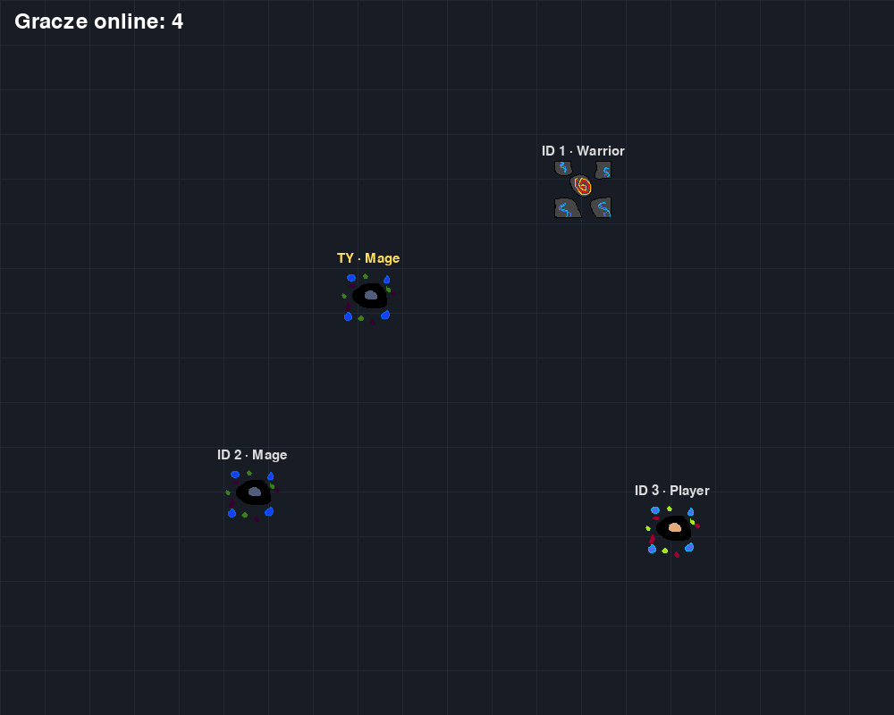
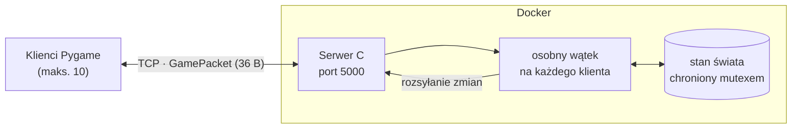

# MultiPlatformGame – gra multiplayer klient–serwer

Wieloosobowa gra 2D czasu rzeczywistego: **serwer napisany w C** (wątki POSIX, gniazda TCP, własny binarny protokół), uruchamiany w **Dockerze**, oraz klient w **Pythonie / Pygame**. Każdy gracz wybiera klasę postaci (Player, Mage, Warrior), a serwer synchronizuje pozycje wszystkich graczy w czasie rzeczywistym.



## Technologie

| Część | Technologie |
|---|---|
| Serwer | C, `pthread` (wątek na klienta), gniazda BSD (TCP), mutexy |
| Protokół | binarne pakiety `struct GamePacket` z `#pragma pack(1)` + `union` (36 bajtów) |
| Infrastruktura | Docker, docker compose, Linux |
| Klient | Python, Pygame, `socket` + `struct`, osobne wątki do odbierania i wysyłania |

## Architektura



**Przebieg połączenia:**
1. Klient łączy się, a serwer przydziela mu wolny slot i ID (maks. 10 graczy).
2. Serwer wysyła nowemu graczowi jego ID oraz aktualny stan wszystkich pozostałych graczy.
3. Klient wysyła pakiet `PACKET_ENTITY_UPDATE` przy każdej zmianie pozycji. Serwer weryfikuje ID i klasę (klient nie może się podszyć pod innego gracza), zapisuje stan i rozsyła go do pozostałych.
4. Po rozłączeniu slot jest zwalniany.

**Protokół** (`Server/protocol.h` ↔ `Gra/client.py`, format `struct` `<iiiffiiii`):

| Pole | Typ | Znaczenie |
|---|---|---|
| `category` | int | `ENTITY_UPDATE`, `ACTION`, `MAP_DATA` |
| `entity_type` | int | `PLAYER`, `MAGE`, `WARRIOR`, `TOWER` |
| `id`, `x`, `y`, `size`, `hp` | int / float | wspólna baza każdej postaci |
| `v1`, `v2` | int | pola zależne od klasy (np. mana i siła czarów maga) |

Pakiety mają stały rozmiar, więc po obu stronach odczyt czeka na komplet bajtów (`MSG_WAITALL` w C, `_recv_exact` w Pythonie). TCP jest strumieniem i może dzielić dane na kawałki.

## Uruchomienie

**Serwer (Docker):**
```bash
cd Server
docker compose up --build
```

**Serwer bez Dockera (Linux):**
```bash
gcc -O2 -Wall -o game_server Server/server.c -lpthread
./game_server
```

**Klient** (można uruchomić kilka naraz):
```bash
cd Gra
pip install -r requirements.txt
python main.py
```
Na ekranie startowym wybierasz klasę klawiszem `1`/`2`/`3`, a postacią sterujesz strzałkami.
Aby połączyć się z innym komputerem, ustaw `GAME_SERVER_HOST=<adres IP>` (domyślnie `127.0.0.1`).

## Struktura

```
MultiPlatformGame/
├── Server/
│   ├── server.c          # serwer: akceptowanie połączeń, wątki, rozsyłanie stanu
│   ├── protocol.h        # definicja pakietów (wspólna z klientem)
│   ├── Dockerfile
│   └── docker-compose.yml
├── Gra/
│   ├── main.py           # pętla gry: sieć → logika → render
│   ├── client.py         # wątki sieciowe, pakowanie struct
│   ├── Game.py           # Pygame: menu, sterowanie, rysowanie
│   ├── Obj/              # klasy postaci (Player, Mage, Warrior, Tower)
│   └── assets/
└── TODO.md               # plan dalszych prac
```

## Dalsze prace

Szczegóły w [TODO.md](TODO.md). Najważniejsze punkty:
- walka (pakiety `ACTION`: atak, leczenie, wieże),
- pętla gry po stronie serwera (stały tick zamiast przekazywania ruchów),
- walidacja ruchu po stronie serwera (anti-cheat) i obsługa utraty połączenia.
